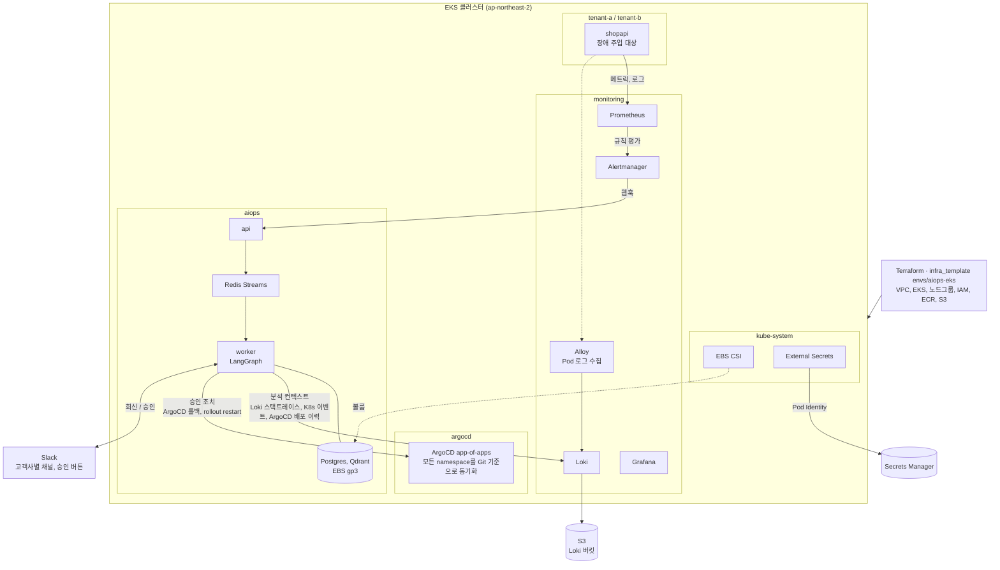

# AI 장애 대응 자동화를 EKS에 올리는 설계

AI 장애 대응 자동화(AI_auto_pipeline)와 대상 서비스(shopapi), 관측 도구, GitOps를 하나의 EKS 클러스터에서 운영한다. 감지, 분석, 보고, 승인 조치까지 사람 개입을 최소로 이어지게 하는 것이 목표다.

상태: 초안. 실행 전 검토용이다. AWS 환경은 이 EKS 클러스터 하나다. 기존 EC2 환경(`envs/aiops-lab`)은 이 설계로 대체하고 지운다(6장 P1a).

테스트 환경은 두 개다. 로컬 K3s(infra_local_set)는 3단계로 이미 운영 중이며 기능 개발과 1차 확인을 맡는다. EKS는 로컬에서 확인된 것을 올려 결과를 측정한다. floci는 Terraform을 실제 계정에 올리기 전에 apply 가능 여부만 확인한다. 이 문서는 설계와 단계 계획까지만 다룬다. 단계별 실행 체크리스트는 7장의 열린 결정이 정해진 뒤 만든다.

## 1. 전제와 제약

| 항목 | 내용 | 근거 |
| --- | --- | --- |
| 자동화 본체 | 이미 있다. api, worker(LangGraph), Postgres, Redis, Qdrant. 알림 입구는 Alertmanager 웹훅. 4단계 EC2용 SQS 입구는 이 설계에서 쓰지 않고 지운다(6장 P1a) | AI_auto_pipeline `app/`, `deploy/k8s/base` |
| 매니페스트 | kustomize base와 overlays/local이 있다 | `deploy/k8s/` |
| 이미지 | api, worker, shopapi가 이미지 하나(`aiops`)를 쓴다. `linux/arm64` | `Dockerfile`, `scripts/build_push.sh` |
| 관측 | kube-prometheus-stack, Loki, Alloy. 알림 규칙과 어댑터가 이 스택 기준이다 | plan.md 9-2, 9-3 |
| 고객사 분리 | tenant-a, tenant-b namespace, 고객사별 Slack 채널 | plan.md 9-7 |
| 인프라 코드 | AWS 리소스는 infra_template에서 Terraform으로만 만든다 | 결정 0013 |
| 비용 | 실습 예산 한도 안에서 운영한다. 클러스터는 상시 운영하지 않고 실험할 때만 만들고 지운다 | 실습 환경 |
| 데이터 | 가짜 데이터만 쓴다. 실제 사용자 트래픽은 없다 | plan.md 1장 |

설계 원칙은 세 가지다.

1. **경계가 분명해야 한다.** AWS 리소스와 클러스터 수명은 Terraform이, 클러스터 안의 상태는 ArgoCD가 소유한다. 한 리소스를 두 도구가 동시에 관리하지 않는다.
2. **로컬과 EKS가 같은 매니페스트를 쓴다.** EKS는 kustomize overlay 하나로 차이를 표현한다. 로컬 K3s에서 안 되는 것을 EKS에서 고치지 않는다.
3. **지우면 0이 되어야 한다.** Terraform 밖에서 생기는 리소스(ELB, EBS, ENI)까지 지우는 절차를 코드로 둔다.

## 2. 전체 구조

## 3. 기술 선택과 근거

각 행은 "무엇을 골랐나, 왜, 무엇을 버렸나"다. 버린 대안의 자세한 이유는 부록 A에 둔다.

### 3.1 AWS 기반

| 영역 | 선택 | 근거 | 버린 대안 |
| --- | --- | --- | --- |
| IaC | Terraform, infra_template `envs/aiops-eks` | 결정 0013과 같은 경계. 상태, CI 스캔, OIDC를 재사용한다. terraform-aws-modules(vpc, eks)로 검증된 구성을 쓴다 | eksctl(상태 관리와 리뷰 흐름이 Terraform과 따로 놀음), CDK |
| 클러스터 | EKS 표준 지원 버전, 관리형 노드그룹 | 컨트롤 플레인의 가용성, 패치, 업그레이드를 AWS가 맡는다. 관리형 노드그룹은 노드 교체, 업그레이드를 콘솔과 API로 다룰 수 있고, 노드를 중지하면 노드그룹이 새 노드로 교체한다(S16) | EKS Auto Mode(노드 관리 수수료가 붙고 노드 장애 실험의 제어권이 줄어듦), Fargate(DaemonSet 불가, node-exporter와 Alloy가 못 뜸), Karpenter(2~3노드 실습에서는 얻는 것보다 부품이 많음) |
| 노드 | Graviton(t4g), 온디맨드, 2대 | 이미지가 이미 arm64다. 같은 성능에서 x86보다 싸다. 스팟은 회수가 실험 측정값을 흔들어서 쓰지 않는다 | x86(t3, 이미지 재빌드 필요), 스팟 |
| 네트워크 | 프라이빗 서브넷 노드, NAT 게이트웨이 1개(단일 AZ), 컨트롤 플레인 엔드포인트 공개 + 허용 IP 제한 | 노드에 공인 IP를 붙이지 않아 인바운드 노출면을 없앤다. NAT는 AZ마다 1개를 두면 AZ 장애에 견디지만, 여기서는 1개로 줄이고 AZ 장애 시 egress가 끊기는 것을 감수한다 | 퍼블릭 서브넷 노드(노드마다 공인 IP가 붙어 노출면이 생김), VPC 엔드포인트만으로 egress(엔드포인트 수 × AZ 요금이 NAT보다 비쌈), NAT 인스턴스(관리할 부품이 늘어남) |
| 워크로드 권한 | EKS Pod Identity | IRSA보다 설정이 단순하고(OIDC 공급자, 신뢰 정책의 조건식 불필요) AWS가 현재 권장하는 방식이다. 서비스 계정마다 최소 권한 역할을 붙인다 | IRSA(동작은 같지만 설정이 더 많음), 노드 역할에 권한 몰아주기(모든 Pod가 같은 권한을 가짐) |
| 이미지 저장소 | ECR, 태그 변경 불가, 푸시 시 스캔 | 노드가 별도 자격 증명 없이 끌어온다. 태그 불변은 "같은 태그 재배포로 버그가 주입되지 않는" 기존 문제(plan.md 11장)를 저장소 수준에서 막는다 | Docker Hub, GHCR(풀 자격 증명과 요청 제한 관리 필요) |
| 비밀 | AWS Secrets Manager + External Secrets Operator | LLM API 키, Slack 토큰, DB 비밀번호를 Git과 Terraform state 밖에 둔다. Git에는 비밀의 이름과 경로만 남는다 | Kubernetes Secret 직접 생성(GitOps로 관리 불가), Sealed Secrets(키 회전과 클러스터 재생성 시 복호화 키 관리 부담. 클러스터를 매번 지우는 이 환경과 맞지 않음) |

### 3.2 클러스터 안

| 영역 | 선택 | 근거 | 버린 대안 |
| --- | --- | --- | --- |
| 배포 | ArgoCD, app-of-apps | 클러스터 상태의 기준이 Git이 된다. 장애 분석에 "직전 배포가 무엇이었나"를 넣을 수 있고, 승인 조치로 롤백을 할 수 있다. 고객사별 AppProject로 권한 경계를 표현한다 | Flux(동기화 기능은 비슷하나, Application 단위 배포 이력 조회와 롤백을 API 하나로 제공하는 것은 ArgoCD), kubectl apply 스크립트(이력이 남지 않음) |
| 설치 순서 | Terraform은 클러스터와 ArgoCD까지만 설치. 나머지 애드온은 ArgoCD가 sync wave로 설치 | Terraform과 ArgoCD가 같은 리소스를 관리하지 않게 한다. 클러스터를 새로 만들 때 Git만 보면 전체가 복원된다 | 모든 애드온을 Terraform helm_release로(상태 드리프트를 Terraform이 못 따라감, plan이 매번 흔들림) |
| 관측 | kube-prometheus-stack, Loki(S3 저장), Alloy, Grafana | 로컬 K3s와 같은 스택이라 알림 규칙, 웹훅 어댑터, 대시보드를 그대로 쓴다. Loki 저장소는 S3로 바꿔 PVC 크기 관리를 없애고, 접근은 Pod Identity로 준다 | Amazon Managed Prometheus·Grafana(샘플 수 과금, 로컬과 구성이 갈림), CloudWatch Container Insights(지표가 거칠고 OOMKilled 같은 규칙을 그대로 쓸 수 없음) |
| 알림 전달 | Alertmanager 웹훅 → aiops api (클러스터 내부) | 자동화가 같은 클러스터에 있으므로 공개 주소, SNS, SQS가 필요 없다. 기존 어댑터를 그대로 쓴다 | SNS→SQS→로컬 자동화(자동화가 클러스터 밖에 있어 중간 단계와 지연이 늘어남) |
| 데이터 | Postgres, Redis, Qdrant를 StatefulSet + EBS gp3로 | 데이터가 가짜이고 클러스터와 함께 지운다. 관리형 서비스를 쓰면 클러스터보다 수명이 긴 리소스가 생기고 비용이 늘어난다. 운영 환경이라면 RDS, ElastiCache로 옮긴다는 판단을 문서에 남긴다 | RDS, ElastiCache(실습 대비 비용과 수명 관리 부담) |
| 외부 노출 | 없음. 사람은 `kubectl port-forward`로 Grafana, ArgoCD를 본다 | LoadBalancer 서비스는 Terraform 밖에서 ELB를 만들어 비용과 삭제 누락 위험을 만든다 | AWS Load Balancer Controller + ALB Ingress(7장 2번 결정에 따라 추가할 수 있음) |
| 고객사 분리 | namespace + ArgoCD AppProject + Alertmanager 라우팅 | 기존 9-7 구조에 배포 권한 경계를 더한다. 고객사마다 배포할 수 있는 namespace와 저장소가 나뉜다 | 고객사별 클러스터(실습 비용 두 배) |

### 3.3 AI 분석과 조치에 더하는 것

| 기능 | 내용 | 근거 |
| --- | --- | --- |
| 배포 이력 컨텍스트 | 장애 접수 시 ArgoCD API로 해당 Application의 직전 sync 리비전, 이미지 태그, 시각을 조회해 분석 입력에 넣는다 | 배포 시각과 장애 시작 시각을 비교해 배포를 원인 후보로 넣거나 뺄 수 있다 |
| K8s 이벤트 컨텍스트 | Pod의 최근 이벤트(BackOff, OOMKilled, FailedScheduling)와 종료 사유를 함께 넣는다 | 스택트레이스가 없는 인프라 장애(S14~S16)의 분류 근거가 된다 |
| 승인 후 조치 | 허용 목록 조치만 실행한다. `argocd-rollback`(직전 정상 리비전), `rollout-restart`. 조치 이름과 대상은 장애 기록에서만 가져오고 LLM 출력은 쓰지 않는다 | plan.md 9-8의 원칙을 앱 계층으로 넓힌다. EKS 관리형 노드에는 SSH가 없으므로 노드 대상 Ansible 조치는 EKS에서 쓰지 않는다 |
| 자동화 권한 | aiops 서비스 계정은 읽기(Pod, 이벤트, 로그)와 ArgoCD의 고객사 Application 롤백 권한만 가진다 | 자동화가 클러스터 전체를 바꿀 수 없게 한다 |

## 4. 장애 시나리오

기존 시나리오를 EKS에서 다시 돌리고, EKS와 GitOps에서만 의미가 있는 것을 더한다.

| ID | 장애 | 감지 | 기대 결과 | 비고 |
| --- | --- | --- | --- | --- |
| S01~S10 | 코드 버그, 외부 지연 | Prometheus, Loki 규칙 | 자동 수정 또는 런북 | 기존 그대로. 이미지 배포만 ArgoCD로 |
| S11, S14 | 기동 실패 반복 | KubePodCrashLooping | 런북 안내 | 기존 |
| S15 | OOMKilled | PodOOMKilled | 런북 안내 | 기존. ArgoCD 자동 복구가 limit 변경을 되돌리지 않게 shopapi 앱은 수동 sync |
| S16 | 노드 장애 | KubeNodeNotReady | 런북 안내, 재개 측정 | 로컬은 VM 중지, EKS는 EC2 중지. 관리형 노드그룹이 교체하는 시간도 함께 측정 |
| S20 | 배포 직후 장애 | 오류율 규칙 | 분석에 직전 배포 포함, 승인 시 롤백, 해소 기록 | 새 시나리오. 배포 이력 컨텍스트와 롤백 조치를 함께 검증한다 |
| S21 | 잘못된 이미지 태그 | KubePodNotReady(ImagePullBackOff) | 배포 이력과 이벤트로 원인 지목, 롤백 안내 | 새 시나리오 |
| S22 | 자원 부족으로 Pending | FailedScheduling 규칙 | 런북 안내(요청량, 노드 용량) | 새 시나리오. 선택 |

## 5. 비용 관리

요금은 서울 리전 공시 가격으로 실행 전에 AWS 요금 계산기에서 다시 계산한다. 아래는 구조상 어디서 돈이 나가는지와 그 통제 방법이다.

| 비용원 | 통제 |
| --- | --- |
| EKS 컨트롤 플레인 (클러스터가 있는 동안 시간당 고정) | 상시 운영하지 않는다. `make eks-up`, `make eks-down`으로 실험 세션 단위로 만들고 지운다 |
| 노드 2대, NAT 1개 | 위와 같음. 노드 크기는 6장 P0의 실측으로 정한다 |
| EBS (PVC) | 클러스터 삭제 전에 PVC를 지우는 절차를 `eks-down`에 넣는다 |
| ELB | LoadBalancer 서비스를 만들지 않는다. 정책으로 막는다(admission 정책 또는 리뷰 규칙) |
| S3 (Loki), ECR | 수명 주기 규칙, `force_destroy`/`force_delete` |
| 잊고 안 지운 클러스터 | 예산 알림은 할인·차감 전 실제 사용 금액 기준으로 건다. 남은 리소스 검사(`lab.sh leftovers` 확장)는 `Project` 태그와 `kubernetes.io/cluster/<이름>` 태그를 모두 본다 |

삭제 순서는 코드로 고정한다. ArgoCD 앱 삭제(하위 리소스까지) → PVC와 Service 정리 대기 → `terraform destroy` → 남은 리소스 검사.

## 6. 단계 계획

각 단계는 끝에 확인할 수 있는 상태가 있다. 앞 단계가 확인되기 전에 다음 단계를 시작하지 않는다.

| 단계 | 내용 | 끝났다는 증거 | 저장소 |
| --- | --- | --- | --- |
| P0 | 사전 측정. 이미 운영 중인 로컬 K3s에서 전체 스택(관측, 자동화, shopapi 2고객사)의 실제 메모리, CPU 사용량을 잰다. ArgoCD 최소 설치 전후도 잰다 | 노드 크기와 대수를 정할 근거 수치 | infra_local_set |
| P1a | EC2 환경 제거. infra_template의 `envs/aiops-lab`, `docs/aiops-lab.md`, README 행, CI validate 대상, 검증 스킬의 `drive aiops-lab`을 지운다. AI_auto_pipeline에서는 SQS 입구(`app/aws.py`, 관련 설정, 테스트, 픽스처), S18, S19, EC2 디스크 런북을 지우고, 결정 0013을 0014(EKS로 대체)로 갱신한다. ECR 푸시 옵션(`build_push.sh`)은 EKS에서도 쓰므로 남긴다 | 두 저장소에서 `aiops-lab`, `AIOPS_SQS`, `cloudwatch` 검색 결과 0건(남기는 ECR 옵션 제외), 기존 테스트 통과, 실제 계정에 `Project=ai-incident` 리소스 0개 | 두 저장소 |
| P1b | `envs/aiops-eks` Terraform. VPC, EKS, 노드그룹, Pod Identity 역할, ECR, Loki S3, Secrets Manager 항목, ArgoCD 설치. `eks-up`, `eks-down`, leftovers 검사 | floci에서 apply 성공(검증 스킬 drive 추가), 실제 계정에서 up → 노드 Ready → down → 남은 리소스 0 | infra_template |
| P2 | GitOps 골격. app-of-apps, sync wave(External Secrets, EBS CSI 설정 → 관측 → 데이터 → 자동화 → 고객사 shopapi), overlays/eks | 빈 클러스터에서 Git만으로 모든 앱 Healthy | AI_auto_pipeline |
| P3 | 기존 경로 재현. S01과 S14를 EKS에서 감지부터 Slack 회신까지 | 로컬 3단계와 같은 결과, 감지 시간과 처리 시간 측정값 | AI_auto_pipeline |
| P4 | 분석 컨텍스트 추가. ArgoCD 배포 이력, K8s 이벤트 | S20, S21에서 분석 결과가 직전 배포를 원인 후보로 지목 | AI_auto_pipeline |
| P5 | 승인 후 조치. 롤백, rollout restart, 조치 기록 | S20에서 승인 1번으로 롤백되고 알림 해소가 기록됨 | AI_auto_pipeline |
| P6 | 고객사 분리와 전체 시나리오 실험, 정리 | 결과 표(로컬 K3s 대 EKS), 비용 실적, 아키텍처 그림 | 두 저장소 |

## 7. 실행 전에 정해야 할 것

| # | 결정 | 선택지 | 추천 |
| --- | --- | --- | --- |
| 1 | 기존 4단계(EC2 + CloudWatch, aiops-lab)의 위치 | 결정됨. EKS로 대체하고 EC2 경로는 지운다 | 보존만 하면 쓰지 않는 Terraform 환경과 SQS 입구 코드를 두 저장소가 계속 유지해야 한다. 코드는 Git 이력에 남는다 |
| 2 | Slack 승인 버튼의 콜백 경로 | (가) Slack Socket Mode(외부 노출 없음) (나) ALB Ingress로 공개 엔드포인트 | (가). 공개 엔드포인트와 인증서 없이 버튼을 받을 수 있다. 3-10이 아직 구현 전이라 지금 정하면 로컬과 EKS가 같은 방식을 쓴다. 동작 여부는 프로토타입으로 확인한다 |
| 3 | 로컬 3단계 마무리 범위 | 3-10(승인 조치)을 로컬에서 먼저 끝낼지, EKS에서 바로 할지 | 승인 조치의 대상이 노드 Ansible에서 롤백으로 바뀐다. 로컬에서도 롤백 방식으로 먼저 만들어 확인한다(원칙 2) |
| 4 | ArgoCD 이미지 갱신 방식 | (가) 실험 스크립트가 ArgoCD API로 이미지 태그를 지정 (나) overlay 커밋 (다) ArgoCD Image Updater | 실험은 (가), 정식 배포 흐름은 (나). 시나리오마다 커밋을 만들면 이력이 흐려진다. 둘을 문서에 구분해 적는다 |

프로토타입으로 정할 것은 두 가지다. 사람에게 물을 일이 아니다.

- P0 실측으로 노드 크기를 정한다.
- Slack Socket Mode로 승인 버튼 이벤트를 받는지 로컬에서 확인한다.

## 부록 A. 버린 대안의 자세한 이유

- **EKS Auto Mode.** 노드 프로비저닝과 애드온을 AWS가 관리한다. 대신 인스턴스 요금에 관리 수수료가 붙고 노드 장애 실험(EC2 중지, 교체 시간 측정)의 제어권이 줄어든다.
- **Karpenter.** 노드 수가 수십 대로 늘거나 워크로드가 들쭉날쭉할 때 이득이 크다. 2~3노드 고정 실습에서는 NodePool, EC2NodeClass, 중단 처리 큐까지 관리할 부품만 늘어난다. 확장 실험이 필요해지면 노드그룹 옆에 추가한다.
- **IRSA.** 동작은 Pod Identity와 같다. Pod Identity는 신뢰 정책의 조건식이 필요 없고, 클러스터를 지웠다 다시 만들 때 OIDC 공급자를 다시 만들 필요가 없다.
- **관리형 관측(AMP, AMG, Container Insights).** 운영 부담을 줄이는 대가로 샘플·지표 단위 과금이 붙는다. 이 프로젝트는 로컬과 같은 규칙과 어댑터를 쓰는 것이 측정 비교(로컬 대 EKS)의 전제라 자체 설치를 고른다.
- **EC2 + CloudWatch 경로(aiops-lab).** 쿠버네티스 없이 EC2 장애만 다룬다. Pod 장애, GitOps 배포 이력, 롤백 같은 이 설계의 핵심을 다룰 수 없어서 EKS로 대체한다. 경보 이름 규칙과 SQS 어댑터는 floci에서 동작이 확인되었지만, 쓰지 않는 입구를 유지하는 비용이 더 크다.
- **SNS→SQS로 로컬 자동화에 전달.** 4단계 EC2 경로에서는 맞는 선택이었다(자동화가 AWS 밖에 있었으므로). EKS에서는 자동화가 같은 클러스터에 있으므로 중간 단계가 이득 없이 지연과 비용만 더한다.

## 부록 B. 위험

| 위험 | 단계 | 대응 |
| --- | --- | --- |
| 클러스터를 안 지워 비용이 쌓임 | 전체 | 세션 단위 up/down, 예산 알림, leftovers 검사 |
| 메모리 부족으로 Pod 축출 | P2 이후 | P0 실측으로 크기 결정, 자원 requests/limits를 모든 매니페스트에 명시 |
| ArgoCD 자동 복구가 장애 주입을 되돌림 | P3 | 고객사 shopapi 앱은 수동 sync, 나머지는 자동 sync |
| Terraform 밖 리소스(ELB, EBS, ENI) 삭제 누락 | P1b | 삭제 순서 스크립트, 클러스터 태그 기준 leftovers 검사 |
| 노드 장애 실험 중 자동화도 같은 노드에서 멈춤 | P6 | aiops와 shopapi를 다른 노드에 배치(nodeSelector 또는 anti-affinity), 기존 9-9의 재개 측정 방식 유지 |
| EKS 버전 지원 종료로 확장 지원 요금 발생 | P1b | 표준 지원 기간 안의 버전만 쓴다 |
